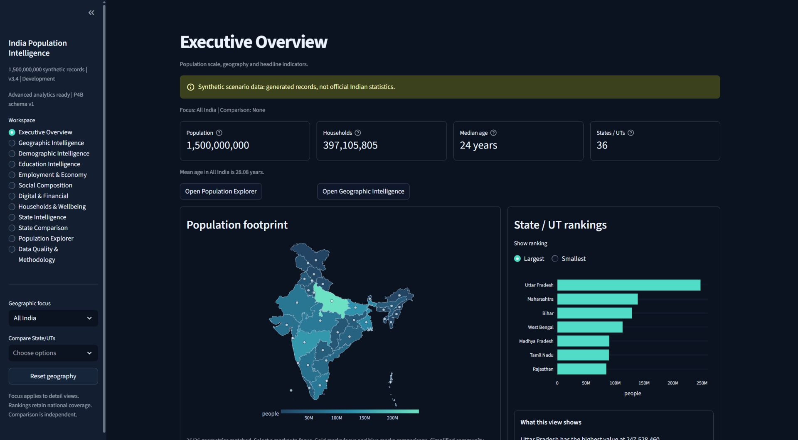
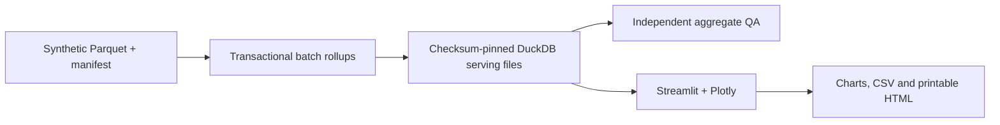

# India Population Intelligence

A Streamlit analytics platform for exploring **1.5 billion synthetic population records**, **397.1 million synthetic households**, and **36 States and Union Territories**. It demonstrates how to build, validate and serve production-scale analytical data on a 16 GB laptop. Every interaction queries compact, precomputed DuckDB aggregates. All outputs describe a synthetic scenario.



## What the project demonstrates

- Resumable, transactional aggregation of 15,000 Parquet shards.
- Portable baseline and multidimensional DuckDB artifacts totaling 16.27 MiB.
- Independently validated counts, eligibility, weighted benchmarks and cross-tab denominators.
- Twelve workspaces, interactive geography, state profiles, comparison reports and analyst exports.
- Python 3.12, Streamlit, DuckDB, Pandas, Plotly and Parquet.

## Workspaces

| Explore | Analyze | Validate |
| --- | --- | --- |
| Executive Overview | Education Intelligence | State Intelligence |
| Geographic Intelligence | Employment & Economy | State Comparison |
| Demographic Intelligence | Digital & Financial | Population Explorer |
| Social Composition | Households & Wellbeing | Data Quality & Methodology |

[Geography](docs/screenshots/geography.jpg) · [Demographics](docs/screenshots/demographics.jpg) · [Education](docs/screenshots/education.jpg) · [Employment](docs/screenshots/employment.jpg) · [State profile](docs/screenshots/state-profile.jpg) · [State comparison](docs/screenshots/state-comparison.jpg) · [Multidimensional Explorer](docs/screenshots/multidimensional-explorer.jpg) · [Methodology](docs/screenshots/methodology.jpg)

## Run locally

Use Python 3.12 from the repository or extracted release root.

```text
python -m venv .venv
```

Windows PowerShell

```powershell
.venv\Scripts\python.exe -m pip install -r requirements.txt
.venv\Scripts\python.exe -m streamlit run app.py --server.address 127.0.0.1
```

Linux or macOS shell

```sh
.venv/bin/python -m pip install -r requirements.txt
.venv/bin/python -m streamlit run app.py --server.address 127.0.0.1
```

Both serving artifacts are discovered under `data/`. `INDIA_DB_PATH` and `INDIA_ADVANCED_DB_PATH` can override the respective files. `INDIA_APP_MODE=production` requires an explicit baseline path and enforces the v3.4 production scope. All serving connections use read-only access.

## Architecture and verification



P4D executed 4,049 independent full-aggregate checks and separately reconciled a 100,000-record shard. The P5 release report records the final test matrix, security advisories, benchmarks and browser coverage. On the Ryzen 7 4800H test laptop, the P5 single-session AppTest run reached the first Overview in 5.68 seconds and rendered the advanced Explorer in 109 ms median. At five concurrent local sessions the advanced Explorer median was 700 ms, with a 219 MiB peak process working set. These timings exclude browser painting and network latency. [Statistical methods and reproduction](docs/p4d-validation.md) · [P5 results](docs/p5-release.md) · [Technical architecture](docs/architecture.md)

## Repository guide

| Location | Purpose |
| --- | --- |
| `app.py`, `workspaces.py`, `intelligence.py`, `ui.py` | Application, profiles, comparisons and presentation |
| `dashboard_data.py`, `advanced_data.py`, `advanced_analytics.py` | Artifact validation and query contracts |
| `build_analytics.py`, `build_advanced.py`, `release_snapshot.py` | Engineering pipelines and serving artifact publication |
| `validate_p4d.py`, `tests/`, `benchmark_release.py` | Statistical, application and performance checks |
| `data/`, `assets/`, `docs/` | Serving artifacts, geometry and documentation |

## Deployment and limitations

The Community Cloud candidate uses root `app.py`, Python 3.12, `requirements.txt`, and the bundled files. Release verification, deployment order and rollback are in the release report. [P5 runbook](docs/p5-release.md)

The model uses historical calibration inputs and synthetic assumptions. It cannot support official estimates, district or mother-tongue analysis, household wealth or exact income percentiles. Potential extensions include additional joint grains and separately validated geographic models. Geographic assets are credited to DataMeet via geoBoundaries and GeoDataViewer. [Attribution and distribution](NOTICE.md)

## Deployment links

[Original public dashboard](https://india-population-intelligence-zqswauvqgeangeb7sgs6tw.streamlit.app/). This branch is the V2 staging candidate. The separate staging URL will be added after hosted verification.
[Proposed V2 release notes](docs/release-v2.md)
