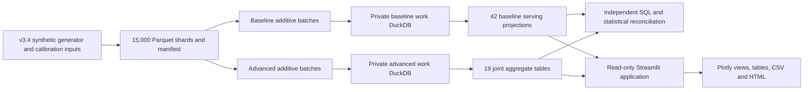
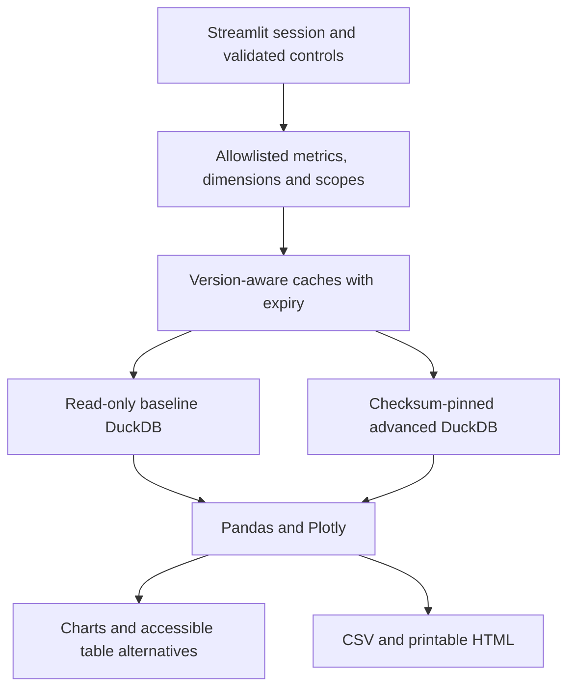

# Architecture and data engineering

## Generation and storage

The v3.4 generator uses historical state and selected demographic calibrations with generated assumptions. State population calibration uses Census 2011 district inputs and a State/UT crosswalk. Employment calibration uses selected PLFS 2025 inputs. The source Parquet inventory consists of 15,000 sequential shards and an immutable manifest. The generator's person and household namespaces assign identifiers within each shard. Advanced aggregation verifies global file-scoped identifier ranges and validates declared household sizes against observed members. The dashboard operates at State/UT and national grain.

## Build and publication

The baseline builder computes additive counts, partial sums and eligible counts in bounded batches. The advanced builder separately writes supported joint grains, including education × age, employment × gender and financial intersections. Each advanced batch records its rollups and ledger entry in the same transaction. Resume checks planned source identities before skipping committed batches. Candidate publication follows logical reconciliation, scope checks and atomic publication into a fresh path. The private work databases retain the information needed for resume. The serving files contain an allowlisted aggregate catalogue and synthetic provenance metadata.

The P4D audit reads published DuckDB aggregates with independent SQL and integer arithmetic. It reconstructs weighted rates and categorical denominators, verifies state and household totals, compares the sanitized baseline with the original analytics projections, and runs a separate bounded shard check. [P4D audit](p4d-validation.md)

## Serving and visualization

The baseline and advanced files resolve relative to the installed app by default. Operators can override their paths with deployment environment variables. The advanced file must match the approved SHA-256 and reconcile against the active baseline. If advanced validation fails, the baseline views remain available. SQL uses allowlisted identifiers with bound user values. Connections are short-lived, read-only and configured with external access disabled, a bounded memory target and no spill for serving. Caches use artifact revisions, expiration and bounded result entries on the analytical paths. A hard-coded CSS block establishes styling without injecting external text.

The metric registry defines eligibility and units. Each cross-tab selects an actual stored joint grain. Integer totals and sums are combined before division. This provides responsive analytical access on a laptop and makes unsupported intersections explicit. Expanding the supported intersection set requires a separate, validated aggregate build.

CSV and HTML are built from the selected aggregate scope in memory. Exports carry synthetic notices, and CSV text and HTML fields are escaped for their formats. The downloadable release archive contains both immutable serving files and local geometry. The candidate uses the same repository-root entry point on a laptop and the intended hosting environment.
